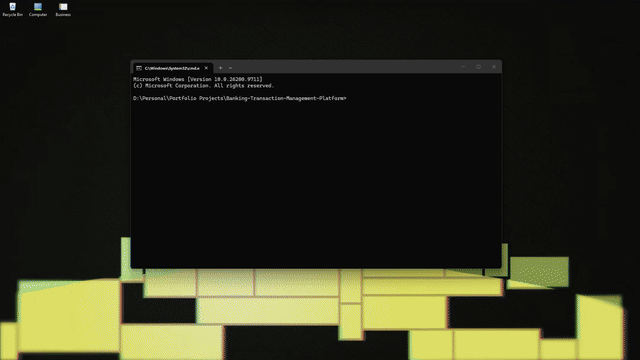
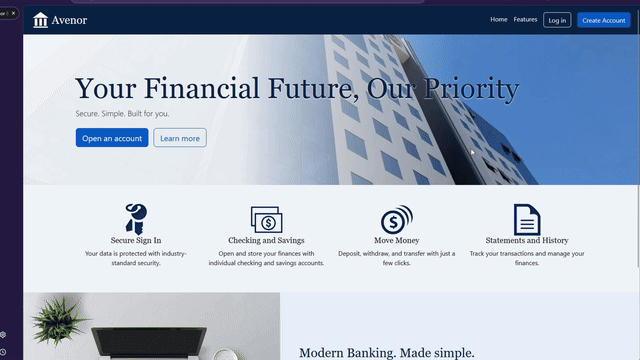

# Avenor Banking & Transaction Management Platform
This repository was intentionally created using very limited to no external help including AI agents or LLMS.


A full-stack banking and transaction management platform built with ASP.NET Core, Entity Framework Core, and SQL Server. Customers will manage checking and savings accounts, move money, and review their history, while administrators freeze and close accounts under an audit trail.




## Highlights

- **One command runs everything:** SQL Server, the API, and the client start with `docker compose up`, in order, gated by health checks.
- **Logout actually logs you out:** access tokens are short-lived JWTs, and every request is checked against the user's current security stamp, so a token stops working the moment its owner signs out.
- **Secure by default:** every API endpoint requires authentication unless it explicitly opts out, and accounts lock for 15 minutes after 5 failed sign-ins.
- **Tested against the real database:** integration tests run against SQL Server in a disposable container, not an in-memory fake.
- **Gated by CI:** every pull request is built, format-checked, tested, and smoke-tested with the same `docker compose up` described below.
- **The browser never sees the API token:** the client keeps it inside an encrypted, HttpOnly session cookie and attaches it to API calls server-side, so scripts in the page can't read it.
- **Accounts can't be overdrawn.** Every balance change is one conditional SQL update that holds the account's row lock, so simultaneous withdrawals are applied one at a time against the latest balance. 
- **History can't be rewritten.** The ledger is append-only: database triggers reject every `UPDATE` and `DELETE`, and every balance is fully explained by its ledger entries.
**Transfers are all or nothing, and can't deadlock.** Both accounts change in one transaction, locked in a fixed order, so opposing transfers queue instead of deadlocking. 
**Customers can't see each other's accounts.** Requesting another customer's account returns `404`.
- **Admin power leaves a permanent trail.** Every freeze, unfreeze, and close requires a reason and is recorded in the same transaction as the change.

## Overview

This project began as a C# banking application I developed during my computer science coursework. The original coursework gave me a foundation, but I wanted to take it further. I decided to rebuild the application under my own direction while reusing what I'd already developed and learned. This gave me the opportunity to make deliberate decisions about the application's structure. With the added freedom I expanded the initial project scope into a **Banking & Transaction Management Platform**. 

## Getting Started

**Prerequisites:** Docker Desktop. For local development and tests you also need the .NET 10 SDK.

You can get the required prerequisites from their respective download pages:
- [Docker Desktop](https://docs.docker.com/desktop/setup/install/windows-install/)
- [.NET 10 SDK](https://dotnet.microsoft.com/en-us/download/dotnet/10.0)


Clone the Project to a source folder onto your local machine.
Ensure Docker Desktop is running.

Then to start, call the following from the respository root:

```bash
docker compose up --build -d
```

The first start takes a minute while SQL Server initializes. Then the backend and front end can be accessed from:

| Service | URL |
| --- | --- |
| Client | http://localhost:5002 |
| API reference (Scalar) | http://localhost:5001/scalar |
| API readiness | http://localhost:5001/health/ready |

Startup is ordered by health checks: the API starts once SQL Server accepts queries, and the client starts once the API reports ready.

---

### Demo Accounts

The demo seeds three customers with about three months of history, including transfers between Alice's accounts and from Alice to Ben.

| Customer | Passwords | Accounts |
| --- | --- | --- |
| `alice@avenor.test` | Avenor-Demo-2026 | Everyday Checking `7301004821`, Holiday Savings `7301007196` |
| `ben@avenor.test` | Avenor-Demo-2026 |  Everyday Checking `7301002457` |
| `cara@avenor.test` | Avenor-Demo-2026 |  Everyday Checking `7301003390`, Rainy Day Savings `7301005512`, Old Checking `7301006604` | 

A staff account, `admin@avenor.test` with the password `Avenor-Admin-2026`, oversees every account. It has its own password, so the customer password never grants admin access. The audit log already explains Cara's frozen and closed accounts: who changed them, when, and why.

**Why the passwords are public:** they exist only to make the demo explorable. Seeding is off by default, runs only in the Docker demo and local development, and the API refuses to start if it's enabled in Production. Accounts lock for 15 minutes after five failed sign-ins, so if one demo account locks, use another or reset with `docker compose down -v`.


---

### Exploring the API

The API ships with an interactive reference, built with [Scalar](https://scalar.com) from the API's OpenAPI document, so you can call every endpoint from your browser. It's available in the Docker demo and in local development, and disabled in any other environment.

1. Open http://localhost:5001/scalar.
2. Call `POST /api/auth/login` with `alice@avenor.test` and `Avenor-Demo-2026`, and copy the `accessToken` from the response. (You can also create your own account with `POST /api/auth/register`.)
3. Open the authentication panel, choose **Bearer**, and paste the token.
4. Call `GET /api/profile` to see your signed-in profile.

#### Things to try

- **Log out and reuse the token.** Call `POST /api/auth/logout`, then `GET /api/profile` again with the same token. The API now returns `401`, because logout rotated the security stamp the token was issued with.
- **Trigger a lockout.** Sign in with a wrong password five times. The sixth attempt is refused, even with the correct password, for 15 minutes.
- **Call a protected endpoint anonymously.** Remove the token and call `GET /api/profile`. The API returns `401` without the endpoint declaring any authorization attribute, because authentication is required by default.
- **Send invalid input.** Register with `not-an-email` or a short password. The response is a `400` problem document listing the error for each field.


### Using the Client

Open http://localhost:5002, choose **Log in**, and sign in with any demo account. You'll land on your profile, which the client loads from the API on every visit. 

#### Things to try

- **Sign out everywhere.** Sign in as Alice in a normal window and a private window. Log out in one, then refresh the profile in the other: the client finds the session revoked and asks you to log in again.
- **Register.** Create your own account. Validation errors from the API appear beside the field they belong to.
- **Transfer money.** From one of Alice's accounts, choose **Transfer**. Move money to her other account, or switch to **To another customer** and send some to Ben at `7301002457`. Both accounts change together, or neither does.
- **See a transfer from both sides.** Alice's history names her own accounts ("Transfer to Holiday Savings"), but Ben's shows hers only as "Transfer from •••• 4821." Neither customer ever sees the other's account names. Sending to Cara's frozen savings (`7301005512`) gets the same message as a number that doesn't exist, so nothing is revealed about it.
- **Read the audit trail.** Sign in as the admin and open **Audit log**. Every status change is there with the reason it was made and who made it, including Cara's checking being frozen for review and then restored.
- **Freeze an account, then feel it.** As the admin, manage Ben's Everyday Checking and freeze it with a reason. Sign in as Ben and try to deposit: it's refused. Unfreeze it afterward, and both changes appear in the log.
- **Cross the line between roles.** As Ben, visit http://localhost:5002/admin/accounts. As the admin, visit http://localhost:5002/dashboard. Each gets "You don't have access to that page."


---


### Configuration

The demo runs with documented, development-only secrets defined in `docker-compose.yml`. Every port is bound to `127.0.0.1`, so nothing is reachable from other machines. To use your own values, set these environment variables before starting the stack:

| Variable | Purpose |
| --- | --- |
| `MSSQL_SA_PASSWORD` | SQL Server SA password. Must meet SQL Server's complexity rules. |
| `JWT_SIGNING_KEY` | Access-token signing key. At least 32 characters. |

SQL Server keeps the password from the volume's first start, so if you change `MSSQL_SA_PASSWORD`, run `docker compose down -v` first.
Outside the Docker demo and local development, the API refuses to start without a signing key, so a misconfigured deployment can't run with a missing or weak key.

#### Resetting

```bash
docker compose down -v
```

This removes the database volume, so the next `up` starts from an empty database.


### Port conflicts

The stack binds ports 1433, 5001, and 5002 on `127.0.0.1`. If one is in use (a local SQL Server instance is the usual cause), stop that service or change the host side of the port mapping in `docker-compose.yml`.

## Local Development

Run only the database in Docker, and the apps from your IDE or the CLI:

```bash
docker compose up -d sqlserver
dotnet run --project BankingAPI/BankingAPI --launch-profile http
dotnet run --project BankingClient/BankingClient --launch-profile http
```

Stop the full stack first (`docker compose down`) if it's running, since the containers and the local apps use the same ports. In development, the API creates and migrates its database on startup.

### Running tests

```bash
dotnet test BankingAPI/BankingAPI.slnx
dotnet test BankingClient/BankingClient.slnx
```
API integration tests start their own disposable SQL Server container through Testcontainers, so Docker must be running. Client tests are fast unit tests with no external dependencies.

## Authors
Hi, my name is [David Wommack](https://github.com/clustermoon). I created this project as a portfolio piece from the incredible advice of the amazing university faculty and staff that have supported me as I shifted from outside industries into the computer science industry. I have 16 years of hobbyist programming, but as of 3 years ago(2023), I shifted into treating my passion as my profession, seeking to attain a degree and pursuing my life's passion of software development. Any Critical feedback is welcome, as I push to constantly improve.

## Feedback and Contributing

Questions and ideas are welcome in [Discussions](https://github.com/clustermoon/Banking-Transaction-Management-Platform/discussions), and bugs or feature requests in [Issues](https://github.com/clustermoon/Banking-Transaction-Management-Platform/issues). 